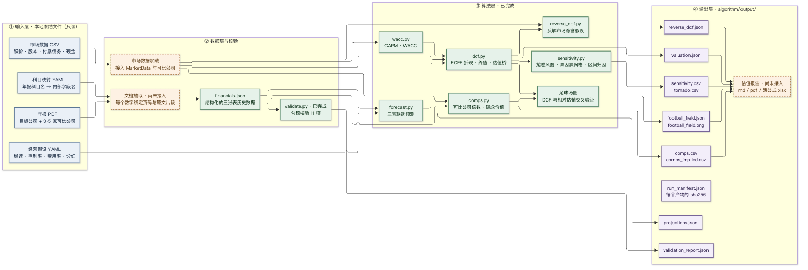
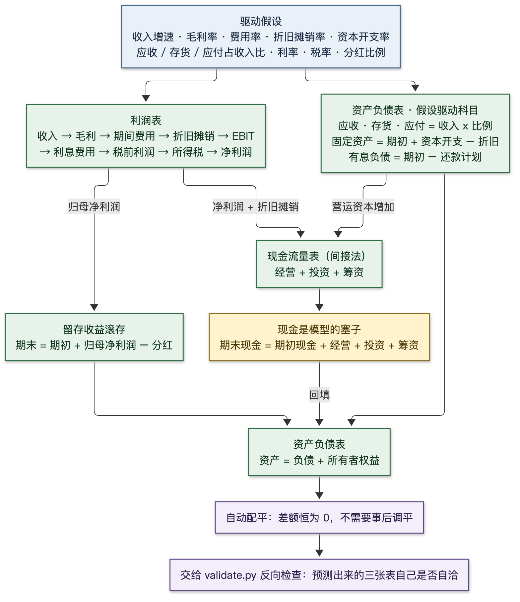

# FinAI

2026 年北京市大学生金融人工智能竞赛「自动化估值建模」方向的实现仓库。

当前进度：算法层九个模块、输出层（数据文件 + 六张图）、框架层九个阶段全部打通。
`make run` 一条命令从配置跑到产物，共 399 个单元测试覆盖
（算法层 345 + 框架层 54）。

- **算法层**（`algorithm/finai/`）：三表联动预测、资本成本、估值引擎、敏感性分析、
  反向求解、相对估值、勾稽校验、财务报表数据结构、输入输出契约。
- **输出层**（`algorithm/output/`）：把结果落成编号数据文件、运行清单与六张图表。
- **框架层**（`pipeline/`）：把上述模块装成一条能跑的流水线 —— 读配置、串流程、留痕迹。

每个算法的输入输出见 [`algorithm/shuoming.md`](algorithm/shuoming.md)。

## 快速开始

核心流程不需要任何第三方依赖，用系统自带的 Python 3.11+ 即可（用到标准库 `tomllib`）。
下面的命令都在仓库根目录 `FinAI/` 下执行：

```bash
python3 -m unittest discover -s algorithm/tests -v
python3 algorithm/examples/dcf_demo.py
python3 algorithm/examples/sensitivity_demo.py
python3 algorithm/examples/validate_demo.py
python3 algorithm/examples/comps_demo.py
python3 algorithm/examples/forecast_demo.py
python3 algorithm/examples/pipeline_demo.py   # 端到端：假设进，文件出
```

注意 `discover` 必须指定 `-s algorithm/tests`：`algorithm` 是命名空间包，
不带参数直接跑 `python3 -m unittest discover` 会找不到测试。

## 依赖

| 范围 | 依赖 | 说明 |
| --- | --- | --- |
| 核心流程 | **无** | 读配置、三表预测、勾稽校验、资本成本、估值、敏感性、落盘、日志 —— 只用标准库 |
| 图表层 | matplotlib | 渲染 6 张图。**没装也能跑通全流程**，只是不生成图表，运行清单里会记一条告警 |

图表是**可选依赖**。装它有三种方式，选一种即可：

```bash
# 方式一：虚拟环境（推荐，不碰系统 Python）
cd FinAI
python3 -m venv .venv
.venv/bin/pip install matplotlib
make run PYTHON=.venv/bin/python      # 用虚拟环境的解释器跑，才会出图

# 方式二：用 Homebrew 装（走 brew 自己的依赖体系）
brew install matplotlib

# 方式三：装到用户目录（不碰系统 Python，但要显式绕开 PEP 668 的保护）
python3 -m pip install --break-system-packages --user matplotlib
```

> **如果直接 `pip install matplotlib` 报 `externally-managed-environment`**：
> 那不是本项目的问题 —— Homebrew 会给它的 Python 打上 `externally-managed` 标记
> （PEP 668），禁止 pip 往系统 Python 里装包，以免和包管理器打架。
> 用上面三种方式之一即可。

### 关键：装的地方和跑的地方要对上

代码只检查「**当前这个 Python 能不能 import matplotlib**」，不关心它装在哪。
所以不管用哪种方式装，都要保证**装的解释器和跑的解释器是同一个**：

| 装在哪 | 怎么跑 |
| --- | --- |
| 虚拟环境 | `make run PYTHON=.venv/bin/python` |
| 系统或用户目录（brew / `pip --user`） | `make run` |

**最常见的坑**：装进了虚拟环境，但跑 `make run` 时忘了带 `PYTHON=`，
于是用回系统 Python，又看到「没有安装 matplotlib」的提示。

排查方法：

```bash
python3 -c "import matplotlib; print('系统 Python 里有')"          # 有 → make run 就能出图
.venv/bin/python -c "import matplotlib; print('虚拟环境里有')"      # 有 → 要带 PYTHON= 跑
```

`.venv/` 已在 `.gitignore` 里，不会被提交 —— 它和机器绑定（路径写死在
`pyvenv.cfg` 里），队友克隆后要自己建一个，一条命令的事。

### 第三方组件说明

（竞赛通知要求：使用第三方开源项目应列明名称、版本、来源、许可证及具体使用范围）

| 名称 | 版本 | 来源 | 许可证 | 使用范围 |
| --- | --- | --- | --- | --- |
| matplotlib | 以实际安装为准 | <https://matplotlib.org> | BSD 兼容许可（见官方 LICENSE） | 仅用于渲染图表；**所有数值计算不依赖它** |

Python 版本要求：**3.11 及以上**（标准库 `tomllib` 从 3.11 开始提供）。

## 系统架构





两张图的源码在 [`docs/`](docs/) 下，是可编辑的 Mermaid 文件，改完按
[`docs/README.md`](docs/README.md) 里的命令重新渲染即可。

## 目录结构

```text
data/                输入：人填的假设与市场快照
  assumptions.toml   经营假设、估值参数、终值、敏感性变量表、基期资产负债表
  market.csv         市场快照：目标公司与可比公司的股价、股本、负债、现金

pipeline/            框架层：把算法模块装成一条流水线（不含任何金融计算）
  config.py          配置层：文件 → 对象，并检查合法性
  adapters.py        适配层：把一种对象翻译成另一种
  tracing.py         留痕层：逐步轨迹 + 运行清单
  run.py             编排层：主流程，按顺序调各阶段
  tests/             框架层测试，验的是「装配」而不是算术

algorithm/
  finai/
    types.py        估值引擎的输入输出契约（经营假设、市场数据、估值结果）
    wacc.py         资本成本：CAPM、债务成本、WACC
    dcf.py          估值引擎：FCFF 预测、折现、终值、估值桥
    sensitivity.py  敏感性分析：龙卷风图、双因素网格、区间归因、CSV 输出
    reverse_dcf.py  反向求解：给定股价反解市场隐含的假设
    statements.py   财务报表数据结构（三张表 + 上期可比数）
    validate.py     勾稽校验：恒等式、现金口径、信号类检查
    comps.py        相对估值：可比公司倍数、隐含价值、足球场图
    forecast.py     三表联动预测：从假设推出完整三张表
  output/           输出层（只依赖 finai，不反向依赖）
    reporting.py    把结果写进 algorithm/runs/<run_id>/
    charts/         一个文件一张图，11 到 16 号
  tests/            单元测试，用手算数字做断言
  examples/         可直接运行的示例脚本
  runs/             运行产物。产物目录统一叫 runs/，避免和包名 output 只差一个 s

runs/<run_id>/       框架层一次运行的产物：01_projections.json … 10_run_manifest.json
logs/<run_id>/       该次运行的轨迹（trace.jsonl）与运行记录（run_manifest.json）
docs/                架构图：Mermaid 源码 + 渲染好的 PNG
```

## 端到端跑一遍

`pipeline_demo.py` 把八个算法模块串起来，一次跑完并落盘：

```text
资本成本 → 三表联动预测 → 勾稽校验 → DCF 估值
→ 敏感性分析 → 反向求解 → 相对估值 → 足球场图 → 写文件
```

每次运行新建一个带时间戳的目录，不覆盖上一次。**文件名前面的编号是固定的**，
数据文件 01 到 10、图表 11 到 16，全目录编号唯一，按文件名字典序排出来就是流水线顺序：

```text
algorithm/runs/20260927T165932/
  01_projections.json        三表联动预测
  02_validation_report.json  勾稽校验报告（可能含多年）
  03_valuation.json          DCF 估值结果
  04_tornado.csv             单因素敏感性排序
  05_sensitivity.csv         双因素敏感性网格
  06_reverse_dcf.json        反向求解出的市场隐含假设
  07_comps.csv               每家公司一行的倍数表
  08_comps_implied.csv       每种倍数的隐含每股价值
  09_football_field.json     估值区间的数据
  10_run_manifest.json       运行清单，含每个产物的 sha256
  charts/
    11_football_field.png      估值区间
    12_tornado.png             单因素敏感性
    13_sensitivity_heatmap.png 双因素敏感性
    14_peer_multiples.png      可比公司倍数
    15_forecast_trend.png      三表预测趋势
    16_validation_summary.png  勾稽校验总览
```

图表层的组织方式和完整对应表见 [`algorithm/output/README.md`](algorithm/output/README.md)。

`run_manifest.json` 是可复现性的凭证：记录每个输出文件的 sha256、字节数，
以及调用方传入的输入说明。两次运行结果不一样时，用它就能判断是输入变了、
代码变了还是假设变了。

## 相对估值的两条路径

| 倍数类型 | 倍数 | 隐含价值怎么算 |
| --- | --- | --- |
| 权益类 | PE、PB、PS | 倍数 x 目标公司的每股指标，直接得到隐含股价 |
| 企业价值类 | EV/EBITDA、EV/EBIT | 倍数 x 目标公司指标 = 隐含企业价值，再减净债务、少数股东权益、优先股，加回非经营性资产，最后除以摊薄股数 |

把 EV/EBITDA 直接乘到每股 EBITDA 上是最常见的错误，测试里专门锁了这条：
基准样本下正确结果是 9.50，错误做法会得到 12.50。

分母为负时倍数没有意义——亏损公司的 PE 不是「便宜」——这类样本会被排除并单独列出，
不参与统计。可比公司通常只有三到五家，按四分位距自动剔除会显著改变结论，
所以异常值剔除默认关闭，只用中位数抗偏。

## 勾稽校验的四类结论

| 结论 | 含义 |
| --- | --- |
| pass | 该平的平了，或差异在容差内 |
| warning | 有差异但存在合理解释空间，或信号类检查被触发 |
| fail | 该平的没平，属于数据错误，必须查 |
| skipped | 输入缺失，无法检查（不等同于通过） |

当前共十一项检查：DQ-01 数据完整性、BS-01 资产负债配平、BS-02 权益构成、
BS-03 未分配利润滚动、BS-04 明细不超总额、CF-01 现金滚动、CF-02 现金口径、
X-01 收入与应收背离、X-02 利润现金转化、X-03 非经常性损益占比、X-04 量级合理性。
另有 X-05 跨期一致性需要两份年报，用 `check_restatement` 单独调用。

DQ-01 排在最前面，专门拦"数据其实没抽到"这种情况：资产、收入、净利润、
经营现金流全为零时，恒等式 0 = 0 + 0 恒成立，会报出一条假通过。

## 单位约定

全项目统一：金额用元，股数用股，比率用小数（0.12 表示 12%）。
中途不要换单位，这是最容易翻车的地方。

## 计算链

```text
收入     = 上期收入 x (1 + 增长率)
EBIT     = 收入 x EBIT 利润率
NOPAT    = EBIT x (1 - 税率)
FCFF     = NOPAT + 折旧摊销 - 资本开支 - 营运资本增加
折现因子 = 1 / (1 + WACC)^t
终值     = FCFF_末 x (1 + g) / (WACC - g)   或   EBITDA_末 x 退出倍数
企业价值 = Σ 现值(FCFF) + 现值(终值)
权益价值 = 企业价值 - 付息债务 + 现金 - 少数股东权益 - 优先股 + 非经营性资产
每股价值 = 权益价值 / 摊薄股数
```

## 下一步

已完成的（原来列在这里的两条）：

已完成的（原来列在这里的两条）：

- **数据层**：读 `data/assumptions.toml`（TOML 而不是 YAML —— 见上面「依赖」一节的理由）、
  `data/market.csv`、`data/peers.csv`，写 JSON 结果、运行日志与逐步轨迹
- **把 `forecast.py` 的 FCFF 接进估值**：由 `pipeline/adapters.py` 完成形状转换。
  两条路径算出的 FCFF 必须一致，有回归测试盯着

还在做的，按依赖顺序：

1. **文档抽取**：年报 PDF 到结构化财报，每个数字绑定页码与原文片段。
   这是数据入口最后一段手工环节 —— 现在 `[opening_balance]` 和 `data/peers.csv`
   都是手填的过渡数据
2. **报告生成**：从各类 json 与 csv 生成估值报告（md / pdf / 活公式 xlsx）。
   数据已经齐了，差的是把数字拼成文章
3. **初赛交付物**：项目计划书与 5 分钟演示视频（截止 10 月 18 日）
